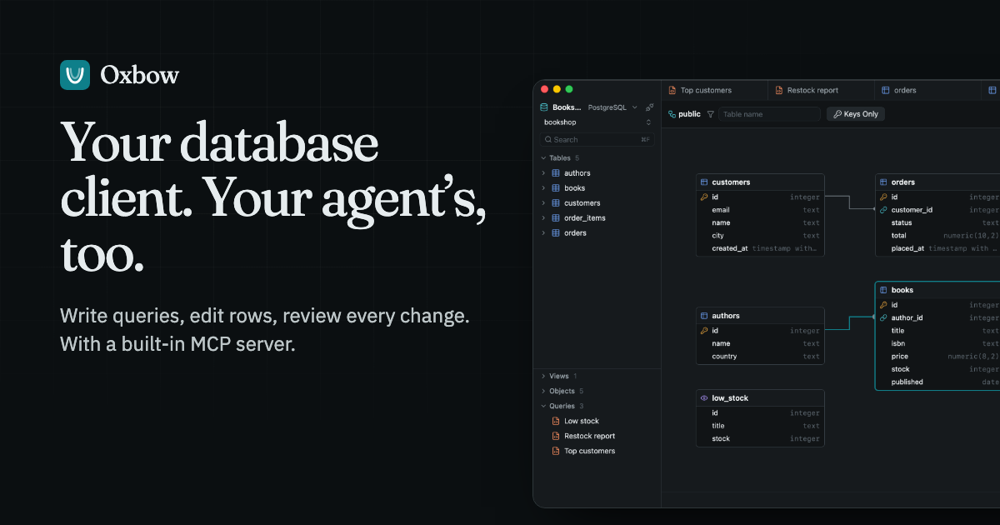
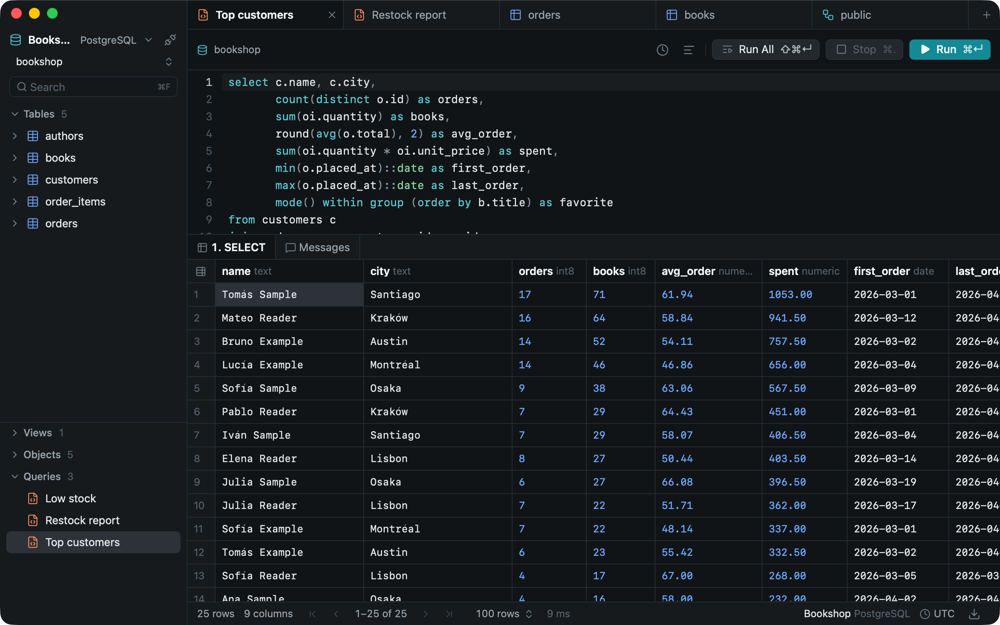
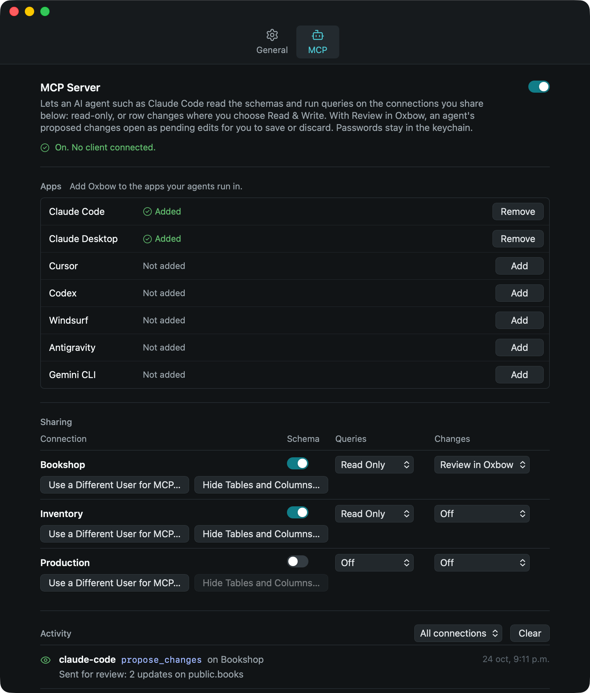

<p align="center">
  
</p>

<p align="center">
  <a href="https://github.com/oxbow-app/releases/releases/latest/download/Oxbow-macOS-arm64.dmg"><strong>Download for macOS</strong></a>
  ·
  <a href="https://github.com/oxbow-app/releases/releases/latest/download/Oxbow-Windows-x64-setup.exe"><strong>Download for Windows</strong></a>
  ·
  <a href="https://github.com/oxbow-app/releases/releases/latest/download/Oxbow-Linux-x86_64.AppImage"><strong>Download for Linux</strong></a>
  ·
  <a href="https://oxbowdb.app/">Website</a>
  ·
  <a href="https://github.com/oxbow-app/releases/releases">Release notes</a>
  ·
  <a href="https://github.com/oxbow-app/releases/issues">Report an issue</a>
</p>

# Oxbow

**Your database client. Your agent’s, too.**

Oxbow is a desktop database client with a built-in MCP server. Write queries, edit rows and review every change.
AI agents connected over MCP get only what you share: writes run only on connections you allow, or wait for your
review as pending edits.

**PostgreSQL · MySQL · MariaDB · SQLite · macOS · Windows · Linux** — free public beta, no account needed.

<picture>
  <source media="(prefers-color-scheme: light)" srcset="assets/editor-light.webp">
  
</picture>

## Features

- **SQL editor** — Completion that reads aliases, Format SQL, saved queries that save themselves, and one result tab
  per statement. Run the statement under the cursor, or all of them.
- **Big results** — Past 10,000 rows, Fetch More and Fetch All read on from the same run, without running the query
  again.
- **Data editing** — Edit, insert and delete rows, in a table or in the result of a query on one table. Each change
  waits as pending with Preview SQL, and Save runs them all in one transaction.
- **Table pages** — Jump to any page, see the row count the database estimates, and Count Rows for the exact number.
- **Schema diagram** — Open any schema as a diagram, with foreign keys drawn as relations. Edit it there: tables,
  columns, indexes, foreign keys and comments, applied only when you say so.
- **Structure** — Columns, keys, indexes, checks and triggers of a table on one page, with its DDL one click away.
- **Import and export** — Bring CSV, TSV, Excel or JSON into a table; save results as CSV, Excel, JSON, SQL, Markdown
  and more.
- **History** — Every statement you run, with its time and rows.
- **Connections** — Paste a connection URL or fill in the form. Search them and organize them in groups. TLS with
  client certificates, SSH tunnels, SQLite files, and passwords kept in the macOS Keychain, the Windows Credential
  Manager or your Linux keyring (GNOME Keyring or KWallet).
- **Light and dark** — Or follow the system.

## Built-in MCP server

Let Claude Code, Claude Desktop, Cursor, Codex, Windsurf, Antigravity or Gemini CLI work with your databases.
Add Oxbow to them in one click from **Settings › Agents**; any other MCP client can be added by hand.

<picture>
  <source media="(prefers-color-scheme: light)" srcset="assets/mcp-light.webp">
  
</picture>

- **Off until you share.** The server and every connection start off, and each connection is shared on its own.
- **You choose what each connection allows.** Schema only, Read Only queries, or Read & Write for single row
  changes that commit at once. Never schema changes.
- **Or review every change.** With Review in Oxbow, an agent’s proposed changes open as pending edits, and nothing
  runs until you save them.
- **Protected connections.** Agents never change their rows directly: their changes always wait for you.
- **The agents’ login.** Oxbow warns you when the database user agents log in as can change data, and
  **Create Read-Only User…** gives them one that can only read.
- **SQL from an agent.** With Open in Editor, an agent can leave a migration in a new tab for you to run. When a
  query of yours fails, Copy for Agent copies it with its error for your agent’s chat.
- **Hide tables and columns** an agent should never see.
- **Limits on every call** — rows, time and calls per minute — and an activity list of every call, without row data
  or passwords. An agent’s long query shows in the status bar, with Cancel.

## Download

Oxbow is in public beta for macOS with Apple Silicon (M1 or later), for Windows 11 or later, and for
Linux on x64.

### macOS

1. Download [`Oxbow-macOS-arm64.dmg`](https://github.com/oxbow-app/releases/releases/latest/download/Oxbow-macOS-arm64.dmg).
2. Open it and drag Oxbow into Applications.
3. The first time you open it, macOS may say it can’t check the app. Open **System Settings › Privacy & Security**
   and choose **Open Anyway**.

### Windows

1. Download [`Oxbow-Windows-x64-setup.exe`](https://github.com/oxbow-app/releases/releases/latest/download/Oxbow-Windows-x64-setup.exe).
   It also runs on Windows on Arm.
2. Run it. It installs for your user only, so it doesn’t need administrator rights.
3. Oxbow isn’t signed with a Microsoft certificate yet, so Windows may say it protected your PC. Choose
   **More info** and then **Run anyway**.

### Linux

1. Download [`Oxbow-Linux-x86_64.AppImage`](https://github.com/oxbow-app/releases/releases/latest/download/Oxbow-Linux-x86_64.AppImage).
2. Make it executable and open it:
   ```sh
   chmod +x Oxbow-Linux-x86_64.AppImage
   ./Oxbow-Linux-x86_64.AppImage
   ```
3. If it asks for FUSE on Ubuntu 24.04 or later, run `sudo apt install libfuse2t64`. If your system has no keyring
   yet, it asks you to create one the first time you save a password.

Oxbow updates itself from then on: when a new version is out, it asks before installing.

## Feedback

Bug reports, ideas and questions are welcome in [Issues](https://github.com/oxbow-app/releases/issues), or from
Oxbow itself with **Settings › General › Report a Problem…**, which fills in your version.

---

© 2026 Diego Inostroza. All rights reserved.
