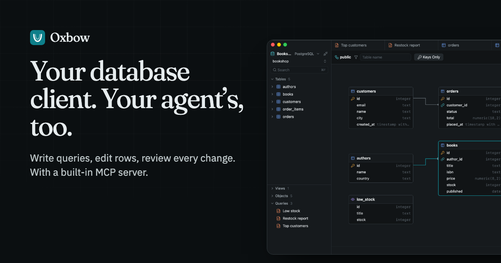
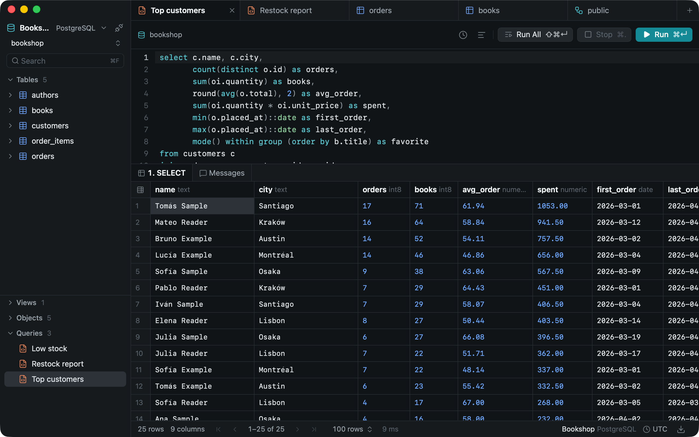
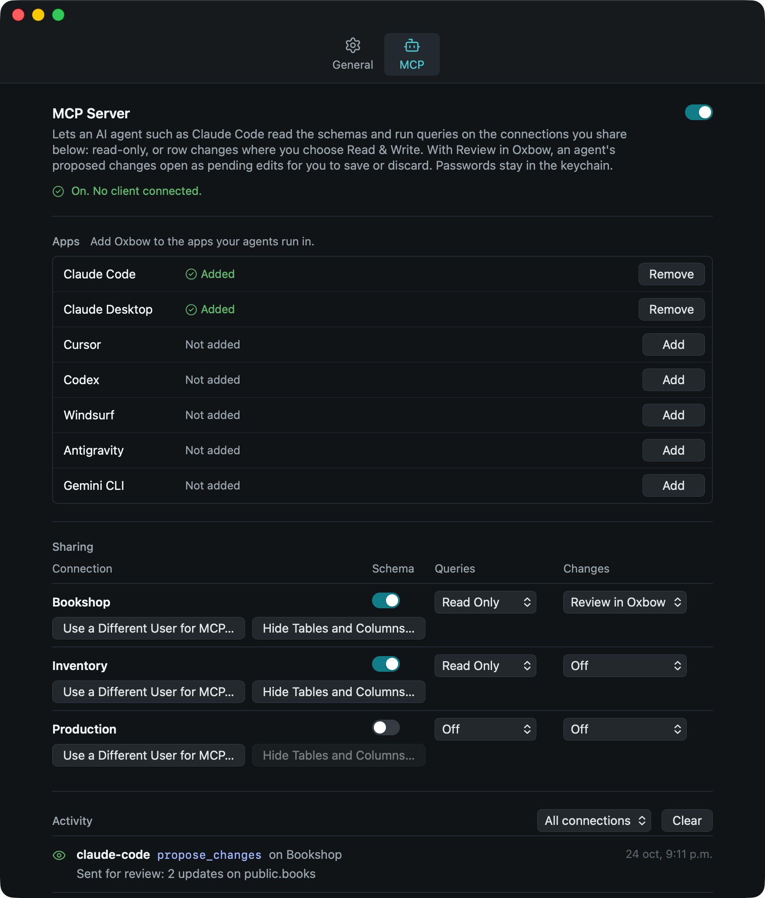

  

  <a href="https://github.com/oxbow-app/releases/releases/latest/download/Oxbow-macOS-arm64.dmg"><strong>Download for macOS</strong></a>
  ·
  <a href="https://oxbowdb.app/">Website</a>
  ·
  <a href="https://github.com/oxbow-app/releases/releases">Release notes</a>
  ·
  <a href="https://github.com/oxbow-app/releases/issues">Report an issue</a>

# Oxbow

**Your database client. Your agent’s, too.**

Oxbow is a desktop database client with a built-in MCP server. Write queries, edit rows and review every change.
AI agents connected over MCP get only what you share: writes run only on connections you allow, or wait for your
review as pending edits.

**PostgreSQL · MySQL · macOS** — free public beta, no account needed.

<picture>
  <source media="(prefers-color-scheme: light)" srcset="assets/editor-light.webp">
  
</picture>

## Features

- **SQL editor** — Completion that reads aliases, Format SQL, saved queries that save themselves, and one result tab
  per statement. Run the statement under the cursor, or all of them.
- **Data editing** — Edit, insert and delete rows. Each change waits as pending with Preview SQL, and Save runs them
  all in one transaction.
- **Schema diagram** — Open any schema as a diagram, with foreign keys drawn as relations. Edit it there: tables,
  columns, indexes, foreign keys and comments, applied only when you say so.
- **Structure** — Columns, keys, indexes, checks and triggers of a table on one page, with its DDL one click away.
- **Import and export** — Bring CSV, TSV, Excel or JSON into a table; save results as CSV, Excel, JSON, SQL, Markdown
  and more.
- **History** — Every statement you run, with its time and rows.
- **Connections** — TLS, SSH tunnels, and passwords kept in the macOS keychain.
- **Light and dark** — Or follow the system.

## Built-in MCP server

Let Claude Code, Claude Desktop, Cursor, Codex, Windsurf, Antigravity or Gemini CLI work with your databases.
Add Oxbow to them in one click from Settings; any other MCP client can be added by hand.

<picture>
  <source media="(prefers-color-scheme: light)" srcset="assets/mcp-light.webp">
  
</picture>

- **Off until you share.** The server and every connection start off, and each connection is shared on its own.
- **You choose what each connection allows.** Schema only, Read Only queries, or Read & Write for single row
  changes. Never schema changes.
- **Review in Oxbow.** An agent’s proposed changes open as pending edits, and nothing runs until you save them.
- **Hide tables and columns** an agent should never see.
- **Limits on every call** — rows, time and calls per minute — and an activity list of every call, without row data
  or passwords.

## Download

Oxbow is in public beta for macOS with Apple Silicon (M1 or later).

1. Download [`Oxbow-macOS-arm64.dmg`](https://github.com/oxbow-app/releases/releases/latest/download/Oxbow-macOS-arm64.dmg).
2. Open it and drag Oxbow into Applications.
3. The first time you open it, macOS may say it can’t check the app. Open **System Settings › Privacy & Security**
   and choose **Open Anyway**.

Oxbow updates itself from then on: when a new version is out, it asks before installing.

## Feedback

Bug reports, ideas and questions are welcome in [Issues](https://github.com/oxbow-app/releases/issues), or from
Oxbow itself with **Settings › General › Report a Problem…**, which fills in your version.

---

© 2026 Diego Inostroza. All rights reserved.
